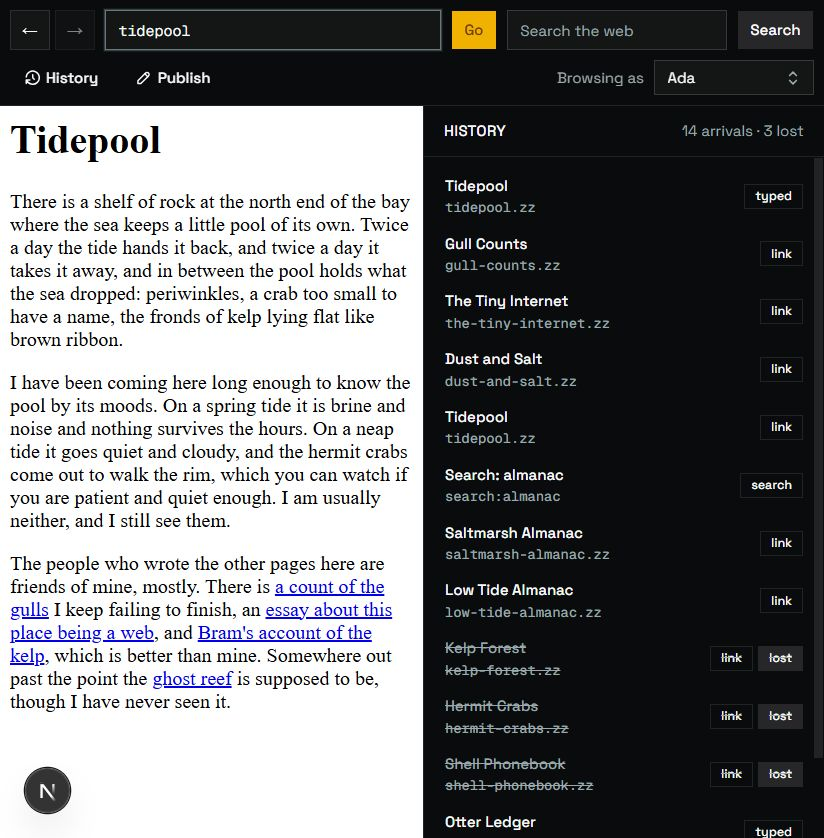

# Wyxan — a small web, and a browser to read it in

A few hundred one-page websites, written by strangers, living in a database. Anybody can publish
another one. This is the thing people look at them with: an address bar, links, back, forward,
history, search, and a record of everywhere you have been.

The web is the content. The browser is the product.



*The browser, reading a published page. The page is served from the API's origin inside a
sandboxed frame; the history on the right is Ada's, with the three forward entries she lost
struck through and marked.*

---

## Run it

```bash
# 0. prerequisites: Node 22+ (24 LTS used), npm 12+, Docker
npm i -g npm@12            # npm 10's resolver crashes on vitest 4's peer graph
git clone <repo> && cd small-web-browser
npm install

# 1. database
docker compose up -d mongo

# 2. seed the web  (idempotent; add -- --reset to rebuild from nothing)
npm run seed

# 3. run both sides, in two terminals
npm run dev:api            # http://127.0.0.1:4000
npm run dev:web            # http://localhost:3000

# 4. tests
npm test                   # unit + integration
npm run test:unit          # unit only
npm run test:e2e           # integration only
npm run lint

# stop the database
docker compose down
```

Open <http://localhost:3000>, pick a name from the list on the right, and start reading.

`npm run seed` is safe to run again: the web does not double. Add `-- --reset` to rebuild it from
nothing.

---

## What it does

**Browse.** Type an address and press Enter. `tidepool`, `TIDEPOOL`, `tidepool.zz`,
`http://tidepool.zz/` and `http://localhost:3000/tidepool.zz` all mean the same page. A link inside
a published page navigates the browser, and a link to an address that has never existed lands on a
truthful "no such address" page — which is still an arrival, and still goes in the history.

**Retrace.** Back and forward move a cursor over the arrival log. They never create an arrival and
never rewrite one. Going back after going back and then typing a new address *loses* the forward
entries — and the history panel shows them, struck through and marked **lost**, rather than
quietly deleting them.

**Restore on return.** Every arrival keeps a copy of what was on screen. Going back replays that
copy, so a page that has since been replaced still comes back as it was.

**Search.** The search reads what is *written in* the pages, not just their titles. A query that
appears only in a paragraph still finds the page. Results are shown natively, with a passage from
the matching text, and the results themselves take a place in the history — so Back returns you to
the results rather than to whatever the search returns now.

**Publish.** Anyone can publish an address and a page of HTML. The address is taken on success; a
clash is a clear conflict with a suggestion. The page is searchable from the moment it is
published.

**Containment.** Published HTML is never inserted into the browser's own DOM. It is served from a
different origin, inside a sandboxed frame, under a policy that stops it fetching anything. See
*Containment* below.

---

## The model

The one decision everything else follows from:

|  | `visits` | `browserStates.entries` |
| :-- | :-- | :-- |
| What it is | the arrival log | the navigable stack |
| Mutability | append-only, never rewritten | truncatable |
| Holds | every arrival the person ever made | the arrivals still reachable by Back and Forward |
| Forward loss | recorded as `pruned: true` | the entries are removed |

The brief wants both *"a record of everywhere you have been"* and *"forward can be lost"*, and those
pull in opposite directions if history is one list. Two structures — a permanent log and a
truncatable stack — is the only way to satisfy both.

The state machine that drives the stack lives in `packages/shared/src/history.ts` as four pure
functions (`push`, `back`, `forward`, `jump`) with no clock, no network and no database. The API is
a thin wrapper that persists whatever the machine returns, so the server and the tests agree by
construction: they are running the same code.

---

## Containment

Seven layers, and no single one of them is load-bearing:

| # | Layer | What it stops |
| :-- | :-- | :-- |
| 1 | **Origin split** — pages on `127.0.0.1:4000`, the app on `localhost:3000` | cookies, storage, DOM: a published page cannot reach the app at all |
| 2 | **`iframe sandbox="allow-scripts"`** — no `allow-same-origin`, no `allow-forms`, no `allow-popups`, no `allow-top-navigation` | top-level navigation, form submission, popups, same-origin access |
| 3 | **`Content-Security-Policy: sandbox allow-scripts`** | the sandbox applies even if the render URL is opened directly in a tab |
| 4 | **`default-src 'none'`** | every fetch: remote images, fonts, scripts, beacons, exfiltration |
| 5 | **`base-uri 'none'`** | a `<base>` tag hijacking link resolution |
| 6 | **`frame-ancestors <app origins>`** | anyone else framing the page |
| 7 | **`nosniff`, `Referrer-Policy: no-referrer`** | MIME sniffing, referrer leakage |

You can see it:

```bash
curl -I http://127.0.0.1:4000/render/<a-visit-id>
```

**What authors lose, stated plainly.** JavaScript still runs, but with no `localStorage`, no
cookies, no `fetch` to our API, no form submission, no popups, no top-level navigation, and no
outbound network at all. Author pages are, in effect, offline documents. That is the deliberate
trade for making "anyone can publish" safe.

**The one injection.** A sandboxed frame cannot navigate the window that contains it, so without
something to carry the click out, a link inside a published page would do nothing. The render
endpoint injects exactly one script of ours — a click handler that posts the href to the browser
shell, which resolves it against the address of the page on screen and navigates. Everything else
in an author's page is verbatim.

---

## Decisions

Every judgement call, and why. These are the lines the walkthrough points at.

1. **History is a log *and* a stack, and they are different things.** The brief wants both a
   permanent record and a lossy forward stack; one list cannot be both.
2. **Back and forward do not create arrivals.** They move a cursor. A real browser does not add a
   history entry when you press Back, and the arrival's `via` and `visitedAt` still describe how it
   was *first* reached.
3. **A search is an arrival.** Results occupy a place in the history, which is what makes "a search
   and a return to its results" a Back rather than a redo. The results are part of the arrival's
   snapshot, so Back shows the results that were on screen, not a fresh search.
4. **Published pages run JavaScript, in an opaque origin.** The brief expects a web, not a
   document. The cost — no storage, no cookies, no network, no forms — is enforced, not promised.
5. **The render endpoint serves the snapshot, never the live site.** That is what makes restore on
   return exact, and it means the page in the frame and the page in the history can never disagree.
6. **A person is a name from a list.** No accounts, no passwords, no roles: the brief takes
   authentication out of scope, and the name is who the history belongs to.
7. **An address is a normalised string under `*.zz`.** It is the only thing typed into the address
   bar and the only thing an author can point at, so its shape is decided once, in a pure
   function, and used by both the client and the server.
8. **Normalising and resolving are separate.** `normalizeAddress` answers "is this well-formed,
   what is its canonical spelling, is it inside the web" — questions syntax can answer.
   `resolveKind(address, siteExists)` answers "what did arriving here produce". Keeping them apart
   lets the browser preview a navigation without a round trip, and keeps "no such address" and
   "not part of this web" as two different pages rather than one.
9. **The address bar and the search box are separate inputs.** An address is an address; a search
   is a question about what is written in the pages. Two clear inputs are easier to defend than
   one that guesses.
10. **Publishing is create-only, with `replace` as an explicit opt-in.** Editing is not in scope, so
    the common path is a single insert; `replace` exists because it is the sharpest demonstration
    of the snapshot model, and it bumps a version counter.
11. **The API is ESM.** Not a preference: `@nestjs/common@12` ships no CommonJS build, so a
    CommonJS API does not compile (`TS1479`). TypeScript 6.0.3 for the API (the Nest CLI needs the
    programmatic compiler API that TypeScript 7.0 does not expose until 7.1), TypeScript 7.0.2 for
    the shared package and the web app.
12. **npm 12 workspaces.** npm 10's resolver crashes on vitest 4's optional peer graph, which
    fails `npm install` outright. npm 12 resolves the same tree with no flags.
13. **Snippets are drawn from the page's prose, not from the indexed text.** The indexed text has
    been folded for search — no punctuation, plurals removed — so it reads as a bag of words. A
    snippet should read like the page does.
14. **One script is injected into author pages, and it is called out on its own commit.** It is the
    only way a link inside a published page can work at all.

---

## Knowingly left out

No authentication, accounts or roles · no bookmarks, tabs or extensions · no downloads · no hosting
of images or assets · no real network access from published pages · no editing of a published page
beyond `replace` · no scroll-position restoration · no fuzzy matching, autocomplete or synonyms
(search is MongoDB's text index, with its English stemmer and stop-word list, one text index per
collection) · no mobile layout · no Playwright end-to-end suite (the API is covered by an
integration suite against a real MongoDB instead) · no service worker, no offline.

---

## Verify it by hand

- [ ] `npm run seed` twice in a row → the counts do not change.
- [ ] Type `tidepool`, press Enter → the page appears.
- [ ] Type `example.com` → "That address is not part of this web", not "no such address".
- [ ] Click a link inside a published page → the browser navigates.
- [ ] Click a link to an address that has never existed → "No such address".
- [ ] Go back three times, then forward twice → you land where you expect, in that order.
- [ ] Go back three times, then type a new address → the forward entries are gone, and the history
      panel shows them marked **lost**.
- [ ] Search `ledger` → three pages, with the two that are actually about ledgers first.
- [ ] Search, click a result, press Back → you are back at the results.
- [ ] Publish `my-first-page.zz` → you land on it, and it appears in the history.
- [ ] Publish `tidepool.zz` again → a conflict, with a suggestion.
- [ ] `curl -I http://127.0.0.1:4000/render/<a-visit-id>` → the containment headers are there.
- [ ] Replace a page, then go back to it → you see the old version.
- [ ] Switch name → the history changes to that person's.

---

## Where the code is

```
small-web-browser/
├─ PRD.MD · SPEC.MD · PLAN.MD      what to make, how, and in what order
├─ docker-compose.yml              mongo:8
├─ apps/
│  ├─ api/                         NestJS 12 (ESM), port 4000
│  │  └─ src/
│  │     ├─ people/ sites/ visits/ history/ search/ render/
│  │     ├─ common/                configuration, error shape, our own pages
│  │     └─ scripts/seed.ts        the seed command
│  └─ web/                         Next.js 16 App Router, port 3000
│     ├─ app/page.tsx              the browser shell
│     ├─ components/               AddressBar, Viewport, HistoryPanel, PublishPanel…
│     ├─ hooks/use-browser.ts      every navigation, in one place
│     └─ lib/api.ts                the API client
└─ packages/shared/                the logic that has to be right
   └─ src/address.ts history.ts search.ts types.ts
```

`packages/shared` is where the address rules and the history state machine live, as pure
functions with no runtime dependencies. It is compiled to ESM and consumed by both apps under the
name `@small-web-browser/shared`.

## The toolchain

| | |
| :-- | :-- |
| Next.js | 16.4.6, App Router, Turbopack |
| NestJS | 12.5.0, ESM |
| MongoDB | 8 (docker), Mongoose 9.12 |
| TypeScript | 6.0.3 (api), 7.0.2 (shared, web) |
| Tests | vitest 4, `mongodb-memory-server` for the integration suite |
| Lint | oxlint, prettier |
| npm | 12 workspaces |
